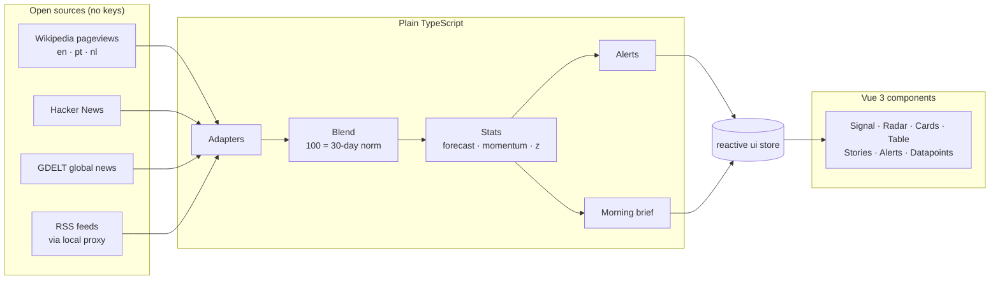

<div align="center">

# PRECOG / Trend Radar

**A morning brief of world attention trends.**
Spot what's starting to move, before it's everywhere.

[**▶ Open the live dashboard**](https://alex-quiterio.github.io/precog-trend-radar/) ·
[Quick start](#quick-start) ·
[How it works](#how-it-works) ·
[Add a data source](#add-a-data-source)

[](https://github.com/alex-quiterio/precog-trend-radar/actions/workflows/pages.yml)


</div>

---

## Why

News feeds tell you what already happened. PRECOG watches **how much attention topics get, day by day**, and flags the moment one breaks from its normal level. It reads open sources: Wikipedia pageviews, Hacker News and global news coverage. It shows each change as a z-score with a short forecast, so you can see a shift while it's still forming.

Open it with your coffee. In about two minutes you know what's running hot, what's quietly climbing, and which stories are spreading fastest.

## What's on the screen

|                       |                                                                                                                                                                                                                                                                                                                                                                                                                                  |
| --------------------- | -------------------------------------------------------------------------------------------------------------------------------------------------------------------------------------------------------------------------------------------------------------------------------------------------------------------------------------------------------------------------------------------------------------------------------- |
| ☀️ **Morning brief**  | What's running hot, the biggest moves, the steadiest climb and the most active lens, plus what changed **since your last look**. One click copies it as Markdown for your daily note.                                                                                                                                                                                                                                            |
| 🔭 **Lenses**         | Themed watchlists: _World, Geopolitics, Climate & energy, Circular economy_ (packaging rules, food waste, CSRD), _Portugal, Land & homestead_ (permaculture, agroforestry, rewilding), _Nederland, Great Simplification_ (degrowth, peak oil, EROI, overshoot, biodiversity loss, Hormuz). Edit any of them: up to 8 lenses of 6 topics each. Local lenses read Portuguese and Dutch Wikipedia and filter news to local outlets. |
| 📈 **Signal**         | The selected topic's history, a dashed 12-step forecast with a ±1σ band, and a hover crosshair. Swipe, drag or press `←` `→` to change topic, and `[` `]` to change lens.                                                                                                                                                                                                                                                        |
| 🚀 **Rising stories** | A [NewsWhip](https://www.newswhip.com/)-style ranking of stories by engagement **per hour**, measured as the page re-checks them, with a 24-hour projection and a **breaking out** flag. Plus story clusters from global news and from Portuguese and Dutch outlets, and the episodes of _The Great Simplification_ podcast that touch your topics.                                                                              |
| 🎯 **Radar**          | A rotating sweep over your lens. Distance shows momentum (centre = rising fastest), size shows volume, and blips ping as the sweep passes.                                                                                                                                                                                                                                                                                       |
| 🚨 **Pre-cog alerts** | Raised when a topic's latest point is more than 2.5σ above its 30-step baseline (**ALERT**), or more than 1.8σ (**WATCH**). Each comes with a plain-English explanation and a projection.                                                                                                                                                                                                                                        |
| 🧾 **Datapoints**     | Official open data: the ECB deposit rate, unemployment (PT / NL / euro area), IPMA fire risk and weather warnings, and today's weather and air quality in Lisbon, Porto and Amsterdam.                                                                                                                                                                                                                                           |
| ♿ **Table view**     | Every topic in every lens in one accessible table. Respects reduced motion. Prints on A4 landscape.                                                                                                                                                                                                                                                                                                                              |

<p align="center"></p>

## Quick start

```sh
git clone https://github.com/alex-quiterio/precog-trend-radar.git
cd precog-trend-radar
npm install
npm run dev        # http://localhost:5173
```

Or skip the setup and use the [hosted version](https://alex-quiterio.github.io/precog-trend-radar/).

`npm run build` writes **one self-contained `dist/index.html`** with all JS and CSS inlined. It opens straight from your file system, with no server.

It opens straight onto **real data** from the World attention index. There's no simulated mode, so nothing on screen is ever made up. A cold start takes up to a minute while the sources answer, and results are cached after that. Press **↻ Refresh** any time.

### Portuguese and Dutch news

RTP, Público, Observador, NOS, NU.nl, DutchNews and NL Times block feed reads from other websites, so the dashboard can't fetch them directly. Run the small local proxy:

```sh
npm run proxy      # node feed-proxy.ts, listening on 127.0.0.1:8787
```

Then open **Rising stories → PT · NL news → set up PT + NL feeds**. The proxy runs on your machine and only fetches the news sites in its allowlist.

## How it works



- **World attention index:** each source is re-based so **100 = its own 30-day median**, then the sources are averaged with weights. Only days that _every_ source has published are used, because sources publish with different delays. Sparse sources (a few items a day) get less weight, and low-volume topics never make the brief's headline claims.
- **Forecast:** linear regression on the last 20 points, projected 12 steps ahead. The band is ±1σ of the residuals.
- **z-score:** the latest point against the previous 30. One topic gets at most one alert every 6 steps, unless a watch escalates.
- **Story velocity:** (points + comments) per hour between two checks at least 5 minutes apart. Before there are two checks, it's the average since the story was posted. The projection assumes engagement levels off: `E(t) = E∞ · (1 − e^(−t/8h))`.

### Sources

| Source                             | Measures                                                 | Notes                                                                         |
| ---------------------------------- | -------------------------------------------------------- | ----------------------------------------------------------------------------- |
| Wikipedia pageviews                | daily views of the topic's article, in the lens language | Titles are resolved automatically, or set exactly with `Name \| wiki: Title`. |
| Hacker News (Algolia)              | stories per day for the exact phrase                     | English lenses. Usually one request per topic, cached per day.                |
| GDELT                              | the topic's share of worldwide news coverage per day     | Allows one request every ~5 s, so it fills in last. Cached for the day.       |
| The Great Simplification           | podcast episodes and Frankly monologues naming a topic   | Public WordPress API. Whole catalogue cached for 12 h. Stories tab only.      |
| GitHub search                      | new repos per week                                       | Allows about 10 requests a minute. Cached for 12 h.                           |
| RSS                                | mentions per day across your feeds                       | Through the local proxy when feeds block browser reads.                       |
| ECB · Eurostat · IPMA · Open-Meteo | the Datapoints panel                                     | Official open data.                                                           |

### GDELT snapshot

GDELT allows one request every ~5 s per network and answers anything faster with a 429, which a browser sees only as `Failed to fetch`. So that every visitor doesn't queue ~50 requests of their own, the Pages workflow runs `scripts/gdelt-snapshot.ts` every 6 hours. It fetches the timelines and 24-hour article lists for the shipped lenses once, from CI, and publishes them as `data/gdelt.json` next to the page. The dashboard reads the snapshot first and only calls GDELT directly for custom topics. When GDELT refuses three times in a row, the browser pauses GDELT for 20 minutes, and the pause survives a reload.

## Privacy and scope

PRECOG tracks **topics, never people**.

- Topic and lens names that look like a person, an @handle or an email are refused. This is a heuristic based on common first names and titles.
- A Wikipedia lookup that resolves to a person's article is skipped.
- Story lists show headlines and outlets. Story authors are never requested.
- Everything stays in your browser (`localStorage`). Nothing leaves your machine except the API requests themselves.

## Project layout

```
src/
├── main.ts                 boot: prefs, mount, data loop, keyboard
├── App.vue                 root layout: header, status, two panel columns
├── types.ts                shared data shapes (Entry, Stats, Alert, Adapter…)
├── core/                   config, person guard, statistics, formatting, ui store
├── sources/                registry + one adapter per source, and the blend
├── features/               morning brief, rising stories, datapoints
├── components/             one Vue component per panel, plus PanelShell, Sparkline, tags
├── state.ts · live.ts · alerts.ts · actions.ts · layout.ts
└── styles/                 tokens (dark default + light), app, print and reduced motion
feed-proxy.ts               allowlisted local feed proxy (node feed-proxy.ts)
tests/                      Vitest unit tests for the pure logic
```

The logic modules are plain TypeScript with no DOM access. They change plain state and call `bump()`, which bumps a version counter in one small reactive store. Each Vue component reads that counter and re-renders.

| Script           | Does                                                     |
| ---------------- | -------------------------------------------------------- |
| `npm run dev`    | Vite dev server with hot reload                          |
| `npm run build`  | type-check, then build the single-file `dist/index.html` |
| `npm test`       | Vitest unit tests (guard, stats, blend, preset upgrades) |
| `npm run lint`   | `vue-tsc` type-check and Prettier check                  |
| `npm run format` | Prettier, configured in `.prettierrc`                    |
| `npm run proxy`  | the local PT/NL feed proxy                               |

Every push to `main` runs lint, tests and the build in GitHub Actions, then deploys `dist/` to GitHub Pages.

## Add a data source

An adapter returns attention points for one topic. Register it, and it appears in the source menu:

```ts
// src/sources/npm-downloads.ts, then add `import './sources/npm-downloads';` to main.ts
import { getJSON, registerAdapter } from './registry';

registerAdapter({
  id: 'npm',
  label: 'npm downloads / day',
  unit: 'downloads',
  weight: 0.2, // optional: weight in a blend
  minMean: 1, // optional: below this daily mean the source counts as sparse
  async fetch(topic, { signal, query }) {
    const j = await getJSON(`https://api.npmjs.org/downloads/range/last-month/${encodeURIComponent(query.q)}`, signal);
    return {
      topic,
      points: j.downloads.map((d: { day: string; downloads: number }) => ({
        t: `${d.day}T00:00:00Z`,
        value: d.downloads,
      })),
    };
  },
});
```

- Throw an `Error` with a short message when there's no data.
- Return `{ topic, points: [], skip: 'reason' }` when the source doesn't apply, for example a non-English lens.
- Respect `signal`.
- Query by topic only.

## License

[MIT](LICENSE)
