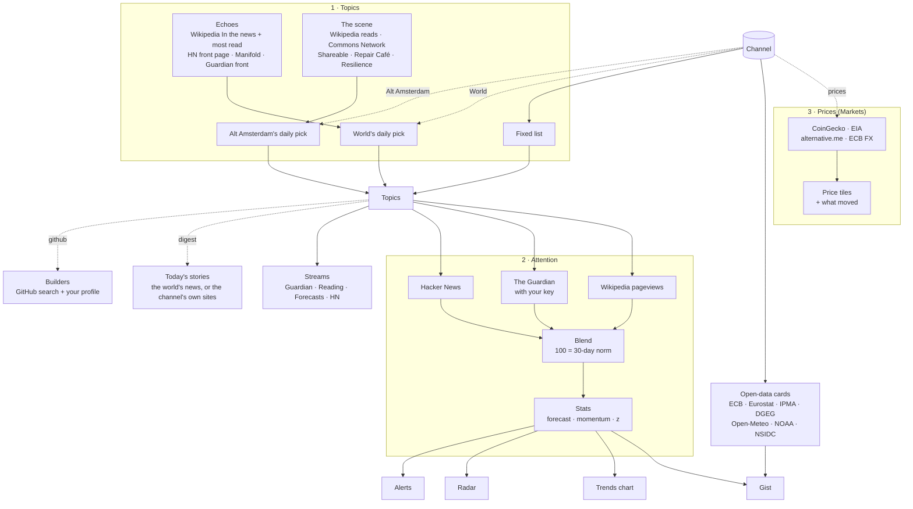

<div align="center">


# PRECOG / Trend Radar

**A personal situation room: pick a channel, get the gist.**
What's moving in the topics you care about, the numbers worth knowing, and what's being written, forecast and built around them.

[**▶ Open the live dashboard**](https://alex-quiterio.github.io/precog-trend-radar/) ·
[Channels](#channels) ·
[Quick start](#quick-start) ·
[How it works](#how-it-works)

[](https://github.com/alex-quiterio/precog-trend-radar/actions/workflows/pages.yml)


</div>

---

## Channels

PRECOG shows one **channel** at a time. A channel is a whole dashboard for one context: switching it switches the topics, the chart, the open data alongside and the streams below.

| Channel                      | Topics it charts                                                                                  | Context (open data)                                                                                                                                                                                                                                               | Streams                                                                                                                     |
| ---------------------------- | ------------------------------------------------------------------------------------------------- | ----------------------------------------------------------------------------------------------------------------------------------------------------------------------------------------------------------------------------------------------------------------- | --------------------------------------------------------------------------------------------------------------------------- |
| **World**                    | Picked daily from what the internet is echoing, leaning toward what you track                     | inflation, ECB rate, unemployment, CO₂                                                                                                                                                                                                                            | **Today's stories**, then Guardian, Forecasts, Hacker News, Reading                                                         |
| **The Great Simplification** | climate change, peak oil, degrowth, overshoot, biodiversity loss, Hormuz                          | CO₂, sea ice                                                                                                                                                                                                                                                      | **Today's stories**, then its episodes and Frankly, Local Futures, Campfire Stories' films, Forecasts                       |
| **The Marginalian**          | poetry, Taoism, Jungian psychology, mysticism, grief, meaning of life                             | —                                                                                                                                                                                                                                                                 | **Today's stories**, then The Marginalian's essays, matched to these topics                                                 |
| **Energy & power**           | renewable energy, solar, wind, energy storage, heat pumps, nuclear                                | **the cheapest 3 hours for power ahead** (PT, NL), renewable share and household energy prices (PT, NL, euro area), **diesel and petrol prices in Portugal (DGEG)**, sun and wind in Lisbon and Amsterdam, CO₂                                                    | Forecasts, The Great Simplification, Hacker News                                                                            |
| **Portugal & the land**      | wildfires, desertification, rainwater harvesting, agroforestry, permaculture, ecovillages         | **your plots of land, side by side** (rain against normal, dry months, heat, frost, soil, fire risk, elevation), IPMA fire risk and warnings, soil in Mafra, Lisbon and Porto weather, **diesel and petrol prices (DGEG)**, Portuguese inflation and unemployment | **Today's stories**, then Wilder, Green Savers, Agroportal (matched in Portuguese), Forecasts                               |
| **Housing**                  | housing crisis, affordable housing, rent control, mortgages, gentrification, short-term rentals   | house prices, rents and mortgage rates for Portugal, the Netherlands and the euro area (separate groups), ECB rate                                                                                                                                                | Reading, Forecasts, Hacker News                                                                                             |
| **Circular economy**         | circular economy, recycling, PPWR, producer responsibility, food waste, CSRD                      | inflation, ECB rate, unemployment                                                                                                                                                                                                                                 | Reading, Hacker News, Forecasts                                                                                             |
| **Alternative Amsterdam**    | Picked daily from what is moving in the scene (co-ops, commons, land trusts, repair, mutual aid…) | Dutch house prices, rents, mortgage rates, renewables and energy prices; Amsterdam soil and weather; Dutch inflation and unemployment                                                                                                                             | **Today's stories**, then Commons Network, Shareable, Repair Café, Resilience; links to Hipsy's gatherings                  |
| **Markets**                  | S&P 500, Treasury yields, oil prices, gold, Bitcoin, recession                                    | **real prices** of oil, US stocks and AI leaders, AI tokens, crypto, gold and currencies; the euro area's 10-year yield, ECB rate, inflation; **the seven largest economies** by GDP (World Bank)                                                                 | **Today's stories**, then Guardian, Forecasts, Hacker News                                                                  |
| **Bird migration**           | white stork, black-tailed godwit, spoonbill, common crane, starling, barn swallow                 | **the flyway**: birds crossing the weather radars from the North Sea to the Algarve each night (Aloft); birds crossing near Amsterdam and Lisbon; their weather                                                                                                   | **Today's stories**, then the birds seen this week near Amsterdam and near Lisbon (iNaturalist, your birds first), Guardian |
| **GitHub**                   | AI agents, MCP, Rust, TypeScript, Vue, local-first                                                | new-repo trends, rising projects, **your own stats**                                                                                                                                                                                                              | Hacker News                                                                                                                 |

Every channel has the same four parts, and most open with a fifth, [**Today's stories**](#todays-stories):

- **Gist:** what's running hot, the biggest moves, the steadiest climb, one line on what's hot in the other channels, and what changed since your last look. Copy it as Markdown for a daily note.
- **Trends:** the selected topic's attention, day by day (100 = its own 30-day norm), with a 12-step forecast and a ±1σ band. Add or remove topics; `←` `→` switch topic; `1`–`9` jump to that channel, and `[` `]` step through them.
- **Context:** the open-data cards that matter for that channel, grouped by place (Portugal, Netherlands, Euro area, Planet), with small charts where there's history. A country channel only ever shows its own country's data: Portugal & the land never reports on the Netherlands, and Alternative Amsterdam never on Portugal (not even in the gist's "Elsewhere" line).
- **Radar:** a rotating sweep over the channel's topics. Distance shows momentum (centre = rising fastest), size shows volume; click a blip to chart it.
- **Streams:** **The Guardian** (the newest articles naming the channel's topics, once you add a key), **Reading** (posts from sites you follow, matched to the channel's topics), **Forecasts** (open [Manifold](https://manifold.markets/) markets with the crowd's probability) and **Hacker News** (stories ranked by engagement per hour).

Channels are the ones PRECOG ships with. A channel you made in an earlier version still shows, and the **×** next to its tab deletes it.

### Today's stories

Every channel but Housing, Circular economy, Energy & power and GitHub opens with what is actually happening
with each of its topics, in a sentence, like a daily digest. Each channel tells its stories from its own place or
voice:

| Channel                  | Stories from                                                          | Fresh for | Listed below                         |
| ------------------------ | --------------------------------------------------------------------- | --------- | ------------------------------------ |
| World, Markets           | Wikipedia's **In the news**, and the **Guardian** first (with a key)  | 2 days    | Today in the Guardian (with a key)   |
| The Great Simplification | its episodes and Frankly                                              | 30 days   | New from The Great Simplification    |
| The Marginalian          | its essays                                                            | 30 days   | New on The Marginalian               |
| Portugal & the land      | Wilder, Green Savers, Agroportal, matched in Portuguese               | 2 days    | Today on the land in Portugal        |
| Alternative Amsterdam    | DutchNews.nl, and Commons Network and Repair Café (born in Amsterdam) | 2 days    | Today in the Netherlands (DutchNews) |

On World and Markets, a topic in **In the news** gets that story as its editors wrote it, with the day. With a
Guardian key, a topic the Guardian wrote about in the last two days leads with that headline instead (hours old,
where an In the news entry can be a week old), with the In the news sentence beneath it; those fresh headlines
come first, and **Today in the Guardian** lists its newest articles on the channel's topics (from the trend
fetch, so no extra calls). On the others, a post naming the topic in its title is its story, and the newest
headlines from those sites are listed below the stories, whatever they name. A topic
with no story is listed apart, in one line saying only what it is: its attention moved, but there is no fresh
story to tell, and an encyclopedia's opening paragraph is not news. Each story shows how far the topic's
attention moved in a week (▲ +120% week), why it was picked, and a link to a week of coverage.

### World: what the internet is echoing

World's topics aren't fixed: each morning PRECOG picks the six that stand out, so at a glance you see what the
internet is talking about today. Candidates come from Wikipedia's **In the news** stories (chosen by its
editors) and its **most read** articles (counted by how far above their usual they are). A candidate gains weight
for every other place it shows up: the **Hacker News** front page and **Manifold**'s busiest markets.

With a Guardian key, the **Guardian**'s front joins in too: the topics its editors' picks and most-viewed
articles keep coming back to (their keyword tags, such as "Ukraine" or "Binance") become candidates, matched to
their Wikipedia articles, and its headlines count as echoes. That's two calls a day (one to the Guardian, one to
Wikipedia), plus a Wikipedia search for up to eight tags that don't match an article title. Pages of one story fold into one topic (all the US election
pages become "United States elections"). People, sport, films and shows are left out.

**It leans toward you.** A candidate that names a topic you track in any other channel (or whose Wikipedia
description does) gets a lift worth about one more place echoing it, and the line says so ("near your
Energy & power channel"). It only lifts what the internet is already echoing; it never invents a topic. The
more you track elsewhere, the more World leans your way.

Under the topics, the selected one shows where it is echoing and why it was picked, for example
`In the news · Most read · Manifold — +8 related pages in the most read · 356k reads yesterday · 4 markets on Manifold`.
A pick keeps a head start for three days so the chart doesn't reshuffle on every visit; topics that are new
today say **new**. **Pin** a topic to keep it; one you add yourself is pinned. One you remove stays out of the
picks for a week. If the pick fails (offline, Wikipedia down), World keeps the topics it had.

### Alternative Amsterdam: what is moving in the scene

Alt Amsterdam picks its topics each day too, from a pool of about two dozen subjects of the cooperative,
regenerative city (housing co-ops, community land trusts, commons, squatting, repair, mutual aid, energy and
food co-ops, participatory budgeting, car-free streets…). Each is scored on how much more its Wikipedia
article is read this week than in the month before, and on how often the channel's own sites named it in
the last two months (**Commons Network**, based in Amsterdam; **Shareable**; **Repair Café**, born in Amsterdam;
**Resilience**), a title counting double and older posts less. The best six become the channel's topics; pin,
add and remove work as on World, and a topic you add joins the pool. The Reading stream reads those four
sites, which load only on this channel.

[Hipsy](https://hipsy.nl/) (conscious gatherings in the Netherlands) has no public feed a browser can read:
its [API](https://docs.hipsy.nl/api-reference/list-events) lists one organisation's events, with that
organiser's key. So the channel links to this weekend's gatherings and workshops there instead.

### Markets: real prices, not attention

Markets charts what things cost, not how much they are talked about. It opens with **Prices**: a few
plain sentences on what moved (facts, no forecasts), then a tile per instrument with its price, its real
price curve over the last one or two weeks with the low and high, and its day, week and month moves:

- **Energy:** Brent and WTI crude, $ a barrel (EIA daily spot, a few days behind).
- **Stocks & AI:** the S&P 500 and Nasdaq-100 (SPY and QQQ ETF shares), Nvidia, Microsoft, Alphabet.
- **AI tokens:** Bittensor, Render, NEAR.
- **Crypto:** Bitcoin, Ethereum, Solana, the whole market's value and Bitcoin's share, and the Fear & Greed index.
- **Gold:** $ an ounce.
- **Currencies:** the euro against the dollar, pound, yen, yuan and Swiss franc, and the dollar against the yen
  (ECB reference rates).

US shares and indices are priced through tokenized shares (xStocks on CoinGecko), which trade around the clock
and track the listed price; there is no keyless stock-market feed a browser may read. A tokenized oil fund was
left out on purpose: it trades a few dollars a day and its price was far from the real one. Then come Today's
stories and the news, as on World; the attention chart, gist and radar are left out. Five calls a load, each
cached (CoinGecko for ten minutes, as it throttles keyless callers).

### GitHub

The GitHub channel adds a **Builders** section:

<p align="center"></p>

- **Open-source momentum:** new repositories per topic in the last 90 days against the 90 days before, the fastest-growing topic, the language mix of the leading new repos, and the new projects gaining stars fastest.
- **Your GitHub:** public repos, stars, followers, main languages, your public activity over the last 30 days, and what you pushed recently. It reads public data for the username you set (`alex-quiterio` by default; **Change user** to switch).

**GitHub token (optional).** Without one, GitHub allows about 10 searches a minute, so the momentum view takes about two minutes to fill in. With a token it's 30 a minute, and 5,000 profile calls an hour instead of 60. Create a [fine-grained token](https://github.com/settings/personal-access-tokens/new) with **no permissions** (public data is all PRECOG reads), then click **+ Token** on Your GitHub and paste it. It stays in your browser.

### News coverage (The Guardian)

Trend lines blend Wikipedia pageviews with Hacker News for tech topics. To add news coverage, get a free developer key at [open-platform.theguardian.com/access](https://open-platform.theguardian.com/access/) (**Register developer key**; it arrives by email), then open **Settings** (the sliders button in the header), click **+ Add key** and paste it. The key stays in your browser. Guardian article counts per day then join the trend lines for every topic, and **The Guardian** tab in Streams lists the newest articles naming the channel's topics (from the same requests, so it costs no extra calls). The developer tier allows about 500 calls a day; PRECOG caches each topic for the day.

## Quick start

```sh
git clone https://github.com/alex-quiterio/precog-trend-radar.git
cd precog-trend-radar
npm install
npm run dev        # http://localhost:5173
```

Or use the [hosted version](https://alex-quiterio.github.io/precog-trend-radar/).

`npm run build` writes **one self-contained `dist/index.html`** with all JS and CSS inlined. It opens straight from your file system.

## How it works

A channel is four things, set in [`src/channels.ts`](src/channels.ts):

- **Topics** (its lens): what the trend sources, the radar, the streams and the GitHub searches look up. Most
  channels have a fixed list; World and Alternative Amsterdam pick theirs each day.
- **Cards:** the open-data cards it shows, by id.
- **Streams:** the tabs below the chart, and the sites its Reading stream follows.
- **Sections** it turns on or off: `digest` adds Today's stories, `prices` puts the Prices panel in place of the
  gist, chart and radar, `github` adds Builders, `country` keeps a country channel to its own country's data,
  and `links` adds outside links (Hipsy).

Switching channels switches all four. From there, data takes up to three paths:



1. **Topics.** A fixed channel uses its list as is. World scores what the internet is echoing today, and Alt
   Amsterdam scores its pool of scene subjects (both explained above). The best six become the channel's topics,
   and your pins, additions and removals apply on top. Everything below runs on these topics, so on those two
   channels the chart, the streams and the stories change with the day.
2. **Attention.** Each topic is fetched from every trend source, blended into one index and scored. That score
   is what the gist, the trends chart, the radar and the alerts show. The data loop refreshes every 30 minutes
   and keeps what is on screen until new data arrives.
3. **Prices.** Markets doesn't use attention at all. Its quotes go straight to price tiles and a few plain
   sentences on what moved. It still has topics, for its stories and streams.

Alongside these, the **cards** load the open data the channel lists (on Portugal & the land the gist mentions
fire risk and warnings from them). The **streams** look up the channel's topics, or only the selected one.
**Today's stories** gives each topic its news of the day, and **Builders** searches GitHub per topic.

### The numbers

- **Attention index:** each source is re-based so **100 = its own 30-day median**, then the sources are averaged with weights. Only days that every source has published are used. Sparse sources get less weight, and low-volume topics never make the gist's headline claims.
- **Forecast:** linear regression on the last 20 points, projected 12 steps ahead. The band is ±1σ of the residuals.
- **Running hot:** the latest point against the previous 30. Above 2.5σ is an **alert**, above 1.8σ a **watch**.
- **Reading:** The Great Simplification and The Marginalian are always followed (they can't be removed). Any other WordPress site whose public API allows browser reads works too (most do): **follow a site** in the Reading stream. The Great Simplification channel also reads **Local Futures** (localfutures.org: localization and the economics of happiness) and lists **Campfire Stories' films** (campfire-stories.org/film-library): that site can't be read from the browser, so its film library is kept in `src/sources/reading/campfire.ts` and updated by hand. Films are undated and rank as if six months old. Posts that name a topic in the title rank above those that name it in the text, and a match counts half as much for every six months of age.

### Sources

| Source                                | Gives                                                                                             | Notes                                                                                                              |
| ------------------------------------- | ------------------------------------------------------------------------------------------------- | ------------------------------------------------------------------------------------------------------------------ |
| Wikipedia pageviews                   | daily views of each topic's English article                                                       | Titles resolve automatically, or set one with `Name \| wiki: Title`.                                               |
| The Guardian                          | articles per day naming the topic                                                                 | Needs your free key. Cached for the day.                                                                           |
| Hacker News (Algolia)                 | stories per day; stories ranked by engagement per hour                                            | Cached per day.                                                                                                    |
| Manifold                              | open prediction markets, with probability                                                         | 10+ forecasters; questions naming a person are dropped.                                                            |
| Wikipedia feed · Wikidata             | World's daily topics: In the news, most read                                                      | Once a day. Wikidata says which articles are about people.                                                         |
| WordPress sites you follow            | posts matched to the channel's topics                                                             | Cached for 12 h.                                                                                                   |
| DutchNews.nl                          | Alternative Amsterdam's Today's stories: news about the Netherlands                               | The newest 100 posts; cached for 2 h.                                                                              |
| GitHub search and users API           | new repos per topic, rising repos, your public stats                                              | ~10 searches a minute unauthenticated; cached for 12 h / 30 min.                                                   |
| ECB · Eurostat                        | deposit rate, inflation (HICP), unemployment                                                      | PT, NL and the euro area.                                                                                          |
| ECB exchange rates and yield curve    | the euro against USD, GBP, JPY, CNY, CHF; 10-year euro-area yield                                 | Daily.                                                                                                             |
| CoinGecko                             | crypto, AI tokens, tokenized US shares and ETFs, gold (PAX Gold), the crypto market               | Keyless, one call for all quotes; cached ten minutes.                                                              |
| EIA                                   | Brent and WTI spot prices, $ a barrel                                                             | Its public demo key; cached six hours.                                                                             |
| alternative.me                        | the Crypto Fear & Greed index                                                                     | Daily.                                                                                                             |
| World Bank                            | GDP in current US dollars: Markets' seven largest economies                                       | Keyless; yearly, cached for the day.                                                                               |
| EnergyZero · REE (apidatos.ree.es)    | hourly day-ahead power prices: the Netherlands, and the Iberian market Portugal shares with Spain | Keyless; wholesale, before tax. Tomorrow's prices appear around 13:00 CET.                                         |
| DGEG (precoscombustiveis.dgeg.gov.pt) | daily average price of diesel and petrol 95 in Portugal                                           | Across ~1,700 stations; 100 days of history.                                                                       |
| Wikipedia page summaries              | Today's stories: each topic's description                                                         | Cached for the day; "In the news" from the daily feed.                                                             |
| IPMA · Open-Meteo                     | fire risk, warnings, soil moisture, weather, air                                                  | Portugal (Mafra, Lisbon, Porto) and Amsterdam.                                                                     |
| Open-Meteo archive (ERA5)             | Plots: the last 12 months and the 1991–2020 normal at each plot                                   | Keyless. The normal is fetched once per plot and kept; the year once a day.                                        |
| Aloft (aloftdata.eu)                  | birds crossing each weather radar at night: how many, which way, how high                         | European radar bird data, CC0. ~1.5 MB a radar a day, a day or two late; each radar downloaded at most once a day. |
| iNaturalist                           | birds recorded within 40 km of Amsterdam and Lisbon, this week and last                           | Keyless; cached 30 min. Your ten birds are asked for by name, so they show even when rare.                         |
| NOAA · NSIDC (via global-warming.org) | CO₂ at Mauna Loa, global sea ice extent                                                           | With history for the small charts.                                                                                 |

## Privacy and scope

PRECOG tracks **topics, never people**.

- Topic and channel names that look like a person, an @handle or an email are refused. This is a heuristic based on common first names and titles.
- A Wikipedia lookup that resolves to a person's article is skipped, and forecast questions that name a person are dropped.
- World's daily pick leaves out every article Wikidata lists as a person, plus any whose description reads like one ("American politician (born 1984)") and events named after one ("Disappearance of …"). If Wikidata can't answer, the name check above applies too.
- The one exception is **Your GitHub**, which shows the public profile of the username you set yourself.
- Everything stays in your browser (`localStorage`), including the Guardian key. Nothing leaves your machine except the API requests themselves.

## Project layout

```
src/
├── main.ts                 mount the app and start the data loops
├── boot/                   restoring the last view, keyboard shortcuts, page lifecycle, console hooks
├── App.vue                 the channel on screen: hero, gist, trends, builders, streams, context
├── channels.ts             channel definitions
├── types.ts                shared data shapes (Entry, Stats, Adapter…)
├── context.ts              the composition root: makes the app store, data loop, stream loader and actions,
│                           and provides them to every panel (useApp())
├── state.ts                createAppStore(): lenses, topics, the view, persistence
├── actions.ts              createActions(app, services): what the user can do
├── alerts.ts               alert rules
├── live.ts                 the data loop (createLiveLoop: fake sources in, testable)
├── core/                   config and lenses, storage (swappable backend), person guard, statistics, formatting
├── sources/                one folder per source; index.ts lists them all; registries for adapters, streams, cards
│   ├── wikipedia/          index.ts (fetch + adapter) · parse.ts (read replies) · parse.test.ts · fixtures/
│   ├── hackernews/ guardian/ manifold/ reading/ github/
│   ├── echoes/             what the internet is talking about today (Wikipedia's feed, Wikidata, HN, Manifold)
│   └── ecb/ eurostat/ ipma/ open-meteo/ global-warming/     parsers behind the Open data cards
├── features/               gist, streams, datapoints, GitHub momentum, your GitHub, World's daily topic pick
├── components/             one Vue component per panel, each with its own styles, plus PanelShell, Sparkline, tags
└── styles/                 tokens (dark default + light), shared base styles, print and reduced motion
                            Vitest specs sit next to what they test: foo.ts → foo.test.ts, Foo.vue → Foo.test.ts
```

Imports use path aliases: `@core/…`, `@features/…`, `@sources/…`, `@components/…`, and `@/…` for the top-level
modules. App state, including the UI state (status line, theme, clock), lives in one reactive store made by
`createAppStore()`. `context.ts` builds it with everything that works on it (the data loop, the stream loader,
the open-data and GitHub panels' stores, the actions) and provides that to every panel through `useApp()`.
Nothing keeps app state in a module, so any panel, action or loader can be tested with its own context. Only
what is page-wide by nature is shared: the lists of registered sources, the followed sites (a setting kept in
storage), and the queue that keeps GitHub searches inside the browser's rate limit. Each panel re-renders when what it reads changes. Every API reply is read through a typed parser that rejects an unexpected shape
with a clear message, and TypeScript runs in strict mode.

| Script             | Does                                                                              |
| ------------------ | --------------------------------------------------------------------------------- |
| `npm run dev`      | Vite dev server with hot reload                                                   |
| `npm run build`    | type-check, then build the single-file `dist/index.html`                          |
| `npm test`         | Vitest unit tests                                                                 |
| `npm run test:e2e` | the built app in Chromium at phone and desktop widths (run `npm run build` first) |
| `npm run lint`     | `vue-tsc` type-check and Prettier check                                           |
| `npm run format`   | Prettier, configured in `.prettierrc`                                             |

Every push to `main` runs lint, unit tests and the build in GitHub Actions, then the browser tests against the
build (Chromium, phone and desktop widths, every outside API answered from fixtures so they never depend on the
network), then deploys `dist/` to GitHub Pages.

## Add a data source

Each source is a folder in `src/sources/` with its fetching (`index.ts`), its reply parsing (`parse.ts`) and tests
against saved replies. **[docs/ADDING-SOURCES.md](docs/ADDING-SOURCES.md)** walks through the three kinds (a
trend source for the attention index, an Open data card, a stream) with a worked example of each.

## License

[MIT](LICENSE)
