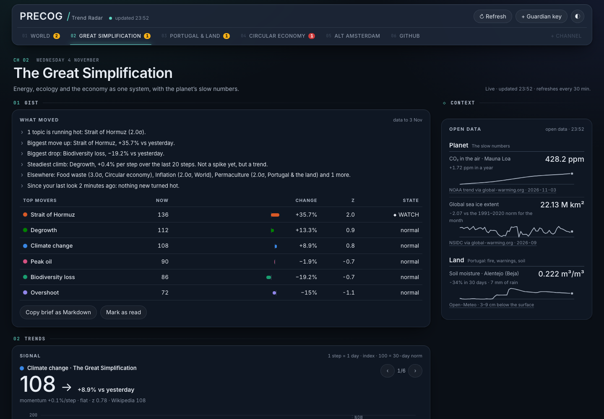
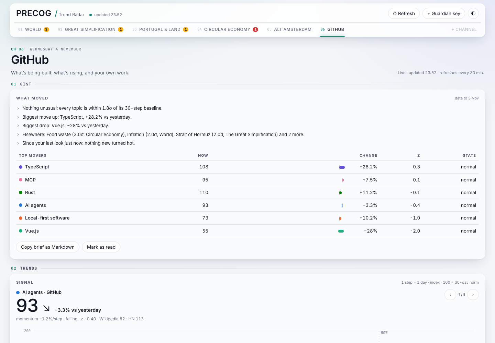
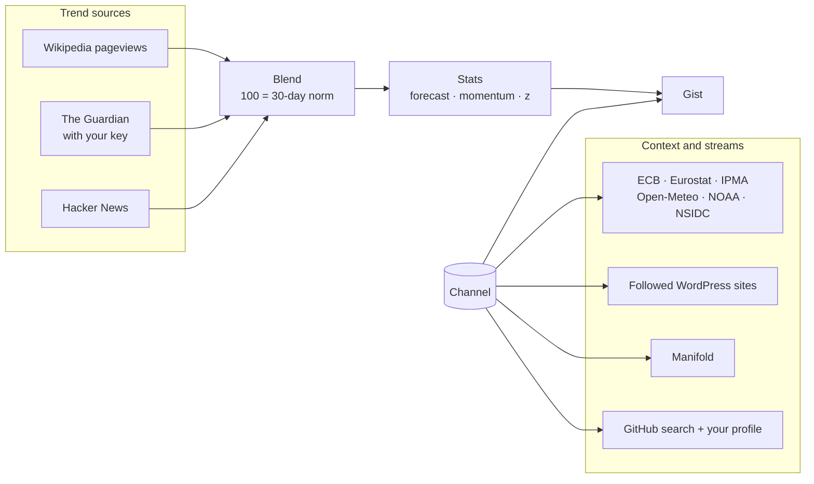

<div align="center">


# PRECOG / Trend Radar

**A personal situation room: pick a channel, get the gist.**
What's moving in the topics you care about, the numbers worth knowing, and what's being written, forecast and built around them.

[**▶ Open the live dashboard**](https://alex-quiterio.github.io/precog-trend-radar/) ·
[Channels](#channels) ·
[Quick start](#quick-start) ·
[How it works](#how-it-works)

[](https://github.com/alex-quiterio/precog-trend-radar/actions/workflows/pages.yml)




</div>

---

## Channels

PRECOG shows one **channel** at a time. A channel is a whole dashboard for one context: switching it switches the topics, the chart, the open data alongside and the streams below.

| Channel                      | Topics it charts                                                                                | Context (open data)                                                                                                               | Streams                                           |
| ---------------------------- | ----------------------------------------------------------------------------------------------- | --------------------------------------------------------------------------------------------------------------------------------- | ------------------------------------------------- |
| **World**                    | Ukraine, Gaza, tariffs, NATO, inflation, AI                                                     | inflation, ECB rate, unemployment, CO₂                                                                                            | Forecasts, Reading, Hacker News                   |
| **The Great Simplification** | climate change, peak oil, degrowth, overshoot, biodiversity loss, Hormuz                        | CO₂, sea ice                                                                                                                      | its episodes and Frankly, Forecasts               |
| **Energy & power**           | renewable energy, solar, wind, energy storage, heat pumps, nuclear                              | renewable share of electricity and household energy prices (PT, NL, euro area), today's sun and wind in Lisbon and Amsterdam, CO₂ | Forecasts, The Great Simplification, Hacker News  |
| **Portugal & the land**      | Alentejo, wildfires, desertification, rural flight, permaculture, regen. ag.                    | IPMA fire risk and warnings, soil in Mafra, Lisbon and Porto weather, Portuguese inflation and unemployment                       | Reading, Forecasts                                |
| **Housing**                  | housing crisis, affordable housing, rent control, mortgages, gentrification, short-term rentals | house prices, rents and mortgage rates for Portugal, the Netherlands and the euro area (separate groups), ECB rate                | Reading, Forecasts, Hacker News                   |
| **Circular economy**         | circular economy, recycling, PPWR, producer responsibility, food waste, CSRD                    | inflation, ECB rate, unemployment                                                                                                 | Reading, Hacker News, Forecasts                   |
| **Alternative Amsterdam**    | doughnut economics, housing co-ops, land trusts, squatting, urban farms, repair cafés           | Amsterdam soil and weather, Dutch inflation and unemployment                                                                      | Reading, Hacker News                              |
| **The Marginalian**          | poetry, consciousness, Stoicism, grief, solitude, meaning of life                               | —                                                                                                                                 | The Marginalian's essays, matched to these topics |
| **GitHub**                   | AI agents, MCP, Rust, TypeScript, Vue, local-first                                              | new-repo trends, rising projects, **your own stats**                                                                              | Hacker News                                       |

Every channel has the same four parts:

- **Gist:** what's running hot, the biggest moves, the steadiest climb, one line on what's hot in the other channels, and what changed since your last look. Copy it as Markdown for a daily note.
- **Trends:** the selected topic's attention, day by day (100 = its own 30-day norm), with a 12-step forecast and a ±1σ band. Add or remove topics; `←` `→` switch topic; `1`–`9` jump to that channel, and `[` `]` step through them.
- **Context:** the open-data cards that matter for that channel, grouped by place (Portugal, Netherlands, Euro area, Planet), with small charts where there's history. A country channel only ever shows its own country's data: Portugal & the land never reports on the Netherlands, and Alternative Amsterdam never on Portugal (not even in the gist's "Elsewhere" line).
- **Radar:** a rotating sweep over the channel's topics. Distance shows momentum (centre = rising fastest), size shows volume; click a blip to chart it.
- **Streams:** **The Guardian** (the newest articles naming the channel's topics, once you add a key), **Reading** (posts from sites you follow, matched to the channel's topics), **Forecasts** (open [Manifold](https://manifold.markets/) markets with the crowd's probability) and **Hacker News** (stories ranked by engagement per hour).

Make your own channel with **+ channel**: give it a name and up to six topics.

### GitHub

The GitHub channel adds a **Builders** section:

<p align="center"></p>

- **Open-source momentum:** new repositories per topic in the last 90 days against the 90 days before, the fastest-growing topic, the language mix of the leading new repos, and the new projects gaining stars fastest.
- **Your GitHub:** public repos, stars, followers, main languages, your public activity over the last 30 days, and what you pushed recently. It reads public data for the username you set (`alex-quiterio` by default; **Change user** to switch).

**GitHub token (optional).** Without one, GitHub allows about 10 searches a minute, so the momentum view takes about two minutes to fill in. With a token it's 30 a minute, and 5,000 profile calls an hour instead of 60. Create a [fine-grained token](https://github.com/settings/personal-access-tokens/new) with **no permissions** (public data is all PRECOG reads), then click **+ Token** on Your GitHub and paste it. It stays in your browser.

### News coverage (The Guardian)

Trend lines blend Wikipedia pageviews with Hacker News for tech topics. To add news coverage, get a free developer key at [open-platform.theguardian.com/access](https://open-platform.theguardian.com/access/) (**Register developer key**; it arrives by email), then click **+ Guardian key** and paste it. The key stays in your browser. Guardian article counts per day then join the trend lines for every topic, and **The Guardian** tab in Streams lists the newest articles naming the channel's topics (from the same requests, so it costs no extra calls). The developer tier allows about 500 calls a day; PRECOG caches each topic for the day.

## Quick start

```sh
git clone https://github.com/alex-quiterio/precog-trend-radar.git
cd precog-trend-radar
npm install
npm run dev        # http://localhost:5173
```

Or use the [hosted version](https://alex-quiterio.github.io/precog-trend-radar/).

`npm run build` writes **one self-contained `dist/index.html`** with all JS and CSS inlined. It opens straight from your file system.

## How it works



- **Attention index:** each source is re-based so **100 = its own 30-day median**, then the sources are averaged with weights. Only days that every source has published are used. Sparse sources get less weight, and low-volume topics never make the gist's headline claims.
- **Forecast:** linear regression on the last 20 points, projected 12 steps ahead. The band is ±1σ of the residuals.
- **Running hot:** the latest point against the previous 30. Above 2.5σ is an **alert**, above 1.8σ a **watch**.
- **Reading:** any WordPress site whose public API allows browser reads works (most do): **follow a site** in the Reading stream. Posts that name a topic in the title rank above those that name it in the text, and a match counts half as much for every six months of age.
- **Channels** are defined in [`src/channels.ts`](src/channels.ts): the lens of topics, the datapoint cards, the streams and the sites each one shows.

### Sources

| Source                                | Gives                                                  | Notes                                                                |
| ------------------------------------- | ------------------------------------------------------ | -------------------------------------------------------------------- |
| Wikipedia pageviews                   | daily views of each topic's English article            | Titles resolve automatically, or set one with `Name \| wiki: Title`. |
| The Guardian                          | articles per day naming the topic                      | Needs your free key. Cached for the day.                             |
| Hacker News (Algolia)                 | stories per day; stories ranked by engagement per hour | Cached per day.                                                      |
| Manifold                              | open prediction markets, with probability              | 10+ forecasters; questions naming a person are dropped.              |
| WordPress sites you follow            | posts matched to the channel's topics                  | Cached for 12 h.                                                     |
| GitHub search and users API           | new repos per topic, rising repos, your public stats   | ~10 searches a minute unauthenticated; cached for 12 h / 30 min.     |
| ECB · Eurostat                        | deposit rate, inflation (HICP), unemployment           | PT, NL and the euro area.                                            |
| IPMA · Open-Meteo                     | fire risk, warnings, soil moisture, weather, air       | Portugal (Mafra, Lisbon, Porto) and Amsterdam.                       |
| NOAA · NSIDC (via global-warming.org) | CO₂ at Mauna Loa, global sea ice extent                | With history for the small charts.                                   |

## Privacy and scope

PRECOG tracks **topics, never people**.

- Topic and channel names that look like a person, an @handle or an email are refused. This is a heuristic based on common first names and titles.
- A Wikipedia lookup that resolves to a person's article is skipped, and forecast questions that name a person are dropped.
- The one exception is **Your GitHub**, which shows the public profile of the username you set yourself.
- Everything stays in your browser (`localStorage`), including the Guardian key. Nothing leaves your machine except the API requests themselves.

## Project layout

```
src/
├── main.ts                 boot: prefs, mount, data loop, keyboard
├── App.vue                 the channel on screen: hero, gist, trends, builders, streams, context
├── channels.ts             channel definitions
├── types.ts                shared data shapes (Entry, Stats, Adapter…)
├── core/                   config and lenses, person guard, statistics, formatting, ui store
├── sources/                registry, trend adapters (Wikipedia, Guardian, HN), Manifold, Reading
├── features/               gist, streams, datapoints, GitHub momentum, your GitHub
├── components/             one Vue component per panel, plus PanelShell, Sparkline, tags
├── state.ts · live.ts · alerts.ts · actions.ts
└── styles/                 tokens (dark default + light), app, print and reduced motion
tests/                      Vitest unit tests for the pure logic
```

The logic modules are plain TypeScript with no DOM access. They change plain state and call `bump()`, which bumps a version counter in one small reactive store. Each Vue component reads that counter and re-renders.

| Script           | Does                                                     |
| ---------------- | -------------------------------------------------------- |
| `npm run dev`    | Vite dev server with hot reload                          |
| `npm run build`  | type-check, then build the single-file `dist/index.html` |
| `npm test`       | Vitest unit tests                                        |
| `npm run lint`   | `vue-tsc` type-check and Prettier check                  |
| `npm run format` | Prettier, configured in `.prettierrc`                    |

Every push to `main` runs lint, tests and the build in GitHub Actions, then deploys `dist/` to GitHub Pages.

## Add a data source

An adapter returns attention points for one topic. Register it, then add its id to `SOURCES.blend.parts` in `src/sources/registry.ts` to blend it into every channel's trend lines:

```ts
// src/sources/npm-downloads.ts, then add `import './sources/npm-downloads';` to main.ts
import { getJSON, registerAdapter } from './registry';

registerAdapter({
  id: 'npm',
  label: 'npm downloads / day',
  unit: 'downloads',
  weight: 0.2, // optional: weight in a blend
  minMean: 1, // optional: below this daily mean the source counts as sparse
  async fetch(topic, { signal, query }) {
    const j = await getJSON(`https://api.npmjs.org/downloads/range/last-month/${encodeURIComponent(query.q)}`, signal);
    return {
      topic,
      points: j.downloads.map((d: { day: string; downloads: number }) => ({
        t: `${d.day}T00:00:00Z`,
        value: d.downloads,
      })),
    };
  },
});
```

- Throw an `Error` with a short message when there's no data.
- Return `{ topic, points: [], skip: 'reason' }` when the source doesn't apply, for example a non-English lens.
- Respect `signal`.
- Query by topic only.

## License

[MIT](LICENSE)
